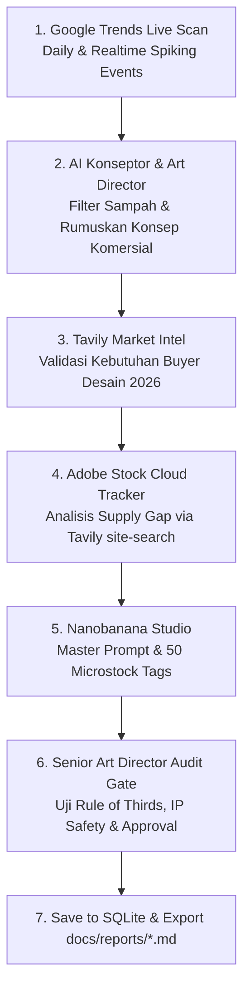

# AGENTS.md — Stock Image Trend Research Pipeline (Tavily-Powered)

Dokumen ini mendefinisikan arsitektur agen, alur kerja (pipeline), spesifikasi tools, tampilan CLI (btop-style TUI), dan panduan operasional untuk agen AI dalam melakukan riset otomatis tren visual stock image (khususnya Adobe Stock) memanfaatkan **Google Trends** dan **Tavily Search API**.

> [!IMPORTANT]
> **Arsitektur Zero Local Scraping**: Seluruh riset web dan pelacakan Adobe Stock dilakukan **100% melalui Tavily Search API di cloud**. Komputer lokal pengguna tidak melakukan web scraping langsung ke `stock.adobe.com`, sehingga **IP pengguna sepenuhnya aman dari risiko IP ban, rate-limit, atau CAPTCHA**.

---

## 1. Visi & Tujuan Proyek

Proyek **stockimgtrend** bertujuan untuk:
1. **Mendeteksi Tren Visual Lebih Awal**: Mengidentifikasi topik, keyword, dan konsep visual yang sedang melonjak (breakout/rising) via Google Trends.
2. **Memperkaya Konteks Riset Pasar**: Menggunakan Tavily Search API untuk mencari artikel industri kreatif, tren musiman, dan kebutuhan visual buyer komersial terkini.
3. **Validasi Kompetisi Adobe Stock via Tavily Cloud**: Memeriksa estimasi volume hasil, keberadaan aset terlaris, dan celah pasar (*supply vs demand gap*) di Adobe Stock dengan query terarah melalui Tavily (`site:stock.adobe.com`).
4. **Tampilan CLI Interaktif Bergaya `btop`**: Menyajikan live dashboard di terminal saat agen menganalisis data, memantau proses scraping, dan menampilkan metrik performa secara real-time.
5. **Autonomous Market Discovery & Inisiatif Tren**: Mesin mengecek riwayat di SQLite, berinisiatif mengajukan kandidat niche komersial baru 2026 yang belum jenuh, dan menyajikan *Opportunity Leaderboard*.
6. **Generator Master Prompt & Tema Kuat Nanobanana**: Meracik 1 Master Prompt fotorealistis/sinematik, negative prompt, dan 50 tag siap generate di Nanobanana dan siap upload ke Adobe Stock.
7. **Penyimpanan SQLite & Ekspor Markdown**: Menyimpan riwayat riset ke `data/stockimgtrend.db` dan mengekspor laporan komprehensif ke `docs/reports/*.md`.

---

## 2. Arsitektur Multi-Agent & Peran

Pipeline dijalankan melalui 4 agen terkoordinasi:



### 1. Google Trends Discovery Agent (`agent_gtrends`)
- **Tugas**:
  - Mengambil data *Daily Search Trends*, *Realtime Search Trends*, dan *Related Queries* (Rising & Top).
  - Melakukan filter berdasarkan kategori komersial (Business, Technology, Seasonal Events, Holiday, Lifestyle).
  - Mengukur *search momentum* (persentase lonjakan keyword).
- **Tools / Library**: `pytrends`, Google Trends RSS feed.

### 2. Tavily Web Intelligence Agent (`agent_tavily`)
- **Tugas**:
  - Menggali data kualitatif tren visual menggunakan Tavily Search API.
  - Query otomatis yang ditargetkan (contoh: `"Adobe Stock visual trends 2026"`, `"commercial photo demand Q2"`, `"high-demand stock vector concepts"`).
  - Meringkas tema visual populer, palet warna, gaya komposisi, dan konsep representasi modern.
- **Tools**: `tavily-python` (Endpoint: Tavily Search API).

### 3. Adobe Stock Tracker via Tavily (`agent_adobestock_tavily`)
- **Tugas**:
  - Melacak keyword target pada Adobe Stock **secara tidak langsung** melalui Tavily Search API:
    - Query pola: `site:stock.adobe.com "{keyword}"`
    - Analisis snippets, metadata judul aset, dan estimasi cakupan aset di Adobe Stock.
  - Mendeteksi *Content Gap* (topik yang banyak dibicarakan di web/Google Trends tetapi hasil terindeks di Adobe Stock masih sangat minim atau usang).
  - **Keamanan**: Tidak ada request langsung dari IP lokal ke Adobe Stock.
- **Tools**: `tavily-python` (Domain filter: `include_domains=["stock.adobe.com"]`).

### 4. Synthesis & Opportunity Scorer Agent (`agent_synthesis`)
- **Tugas**:
  - Menggabungkan data dari ketiga agen dan menghitung **Opportunity Score**.
  - Mengeliminasi keyword yang tidak relevan atau berbahaya (trademark, brand, selebritas, copyright).
  - Membuat *Creative Brief*:
    - Konsep visual / ide pengambilan gambar / ilustrasi.
    - Prompt AI Generation (Midjourney/Flux/Adobe Firefly).
    - Daftar 30–50 keyword siap pakai (disusun berdasarkan relevansi komersial).

---

## 3. Desain Antarmuka CLI (btop-style TUI Dashboard)

Sistem menggunakan **Textual & Rich** di terminal untuk menghadirkan antarmuka visual terpadu layar penuh (*fullscreen interactive dashboard*) menyerupai `btop` dengan navigasi shortcut keyboard:

```text
┌─ stockimgtrend ── [STATUS: ANALYZING] ────────────────────────── [TIME: 09:55:00] ─┐
│ Target Category: Technology & Business  │ Active Keyword: AI Copilot Workspace    │
├──────────────────────────┬──────────────────────────┬──────────────────────────────┤
│ 📈 GOOGLE TRENDS         │ 🌐 TAVILY MARKET INTEL   │ 📦 ADOBE STOCK (via Tavily)  │
├──────────────────────────┼──────────────────────────┼──────────────────────────────┤
│ Velocity : [████████░] 85%│ Buyer Need: High         │ Indexed Assets : ~1,420      │
│ 7-Day Grw: +320% Breakout│ Key Theme : Hybrid Team  │ Gap Score      : [███████░] 78│
│ Queries  : AI workspace  │ Palette   : Warm Tech    │ Saturation     : Low-Moderate│
├──────────────────────────┴──────────────────────────┴──────────────────────────────┤
│ 🎯 OPPORTUNITY SCORE MATRIX / LEADERBOARD                                          │
├────────────────────────────────────────────────────────────────────────────────────┤
│ Keyword                  │ Trend (40%) │ Market (30%) │ Gap (30%) │ TOTAL SCORE    │
│ AI copilot workspace     │ 85          │ 90           │ 78        │ ⭐ 84.4 [HIGH] │
│ Sustainable packaging 3d │ 72          │ 80           │ 88        │ ⭐ 79.2 [GOOD] │
├────────────────────────────────────────────────────────────────────────────────────┤
│ 🍌 NANOBANANA STUDIO: Master Prompt, Negative Prompt & 50 Microstock Tags          │
├────────────────────────────────────────────────────────────────────────────────────┤
│ [HOTKEYS] (a) Auto Discovery | (k) Ketik Keyword | (g) Gen Nanobanana | (h) Riwayat │
└────────────────────────────────────────────────────────────────────────────────────┘
```

### Shortcut Navigasi Keyboard (Hotkeys):
- **`[a]` (Auto Discovery)**: Mesin otomatis mengecek riwayat SQLite, merumuskan 3 topik visual 2026 yang belum jenuh, menganalisis secara live, dan meracik Master Prompt Nanobanana.
- **`[k]` (Ketik Keyword)**: Membuka modal popup input untuk menganalisis topik tertentu langsung di dalam TUI.
- **`[g]` (Generate Nanobanana)**: Meracik Master Prompt Nanobanana dan tema kuat dari hasil riset yang sedang aktif.
- **`[h]` (Riwayat SQLite)**: Membuka popup viewer database untuk melihat riwayat analisis terdahulu.
- **`[c]` (Clear Log)**: Membersihkan log aktivitas.
- **`[q]` (Quit)**: Keluar dari aplikasi TUI.

---

## 4. Spesifikasi Ekspor Laporan Markdown (`.md`)

Setiap analisa yang selesai diekspor ke folder `docs/reports/` dengan format nama file:
`YYYY-MM-DD_<keyword_or_category>_report.md`

### Struktur Isi File Laporan `.md`:
1. **Ringkasan Eksekutif & Opportunity Score**:
   - Total Skor Peluang (0–100) dan Rekomendasi (High / Moderate / Low).
   - Metrik perbandingan Google Trends vs Tavily vs Adobe Stock Gap.
2. **Konteks & Analisis Pasar**:
   - Mengapa topik ini diminati buyer saat ini.
   - Sumber referensi artikel tren visual via Tavily.
3. **Analisis Kompetisi Adobe Stock**:
   - Estimasi jumlah aset yang sudah ada.
   - Celah visual yang belum banyak digarap (*unmet demand*).
4. **Actionable Creative Brief**:
   - Judul aset komersial yang disarankan (*Commercial Title Suggestion*).
   - Tipe aset yang direkomendasikan (Foto, Vektor, 3D, atau Generative AI).
   - **AI Prompt Recipes** (dioptimalkan untuk Midjourney, Flux, dan Adobe Firefly).
   - **30–50 Keyword Siap Pakai** (dalam format tag yang siap disalin/paste ke Adobe Stock Contributor Portal).

---

## 5. Formula Opportunity Score

Untuk menentukan prioritas produksi aset stock image, agen menggunakan bobot metrik:

$$\text{Opportunity Score} = (S_{\text{trend}} \times 0.4) + (S_{\text{tavily}} \times 0.3) + (G_{\text{stock}} \times 0.3)$$

Keterangan:
- **$S_{\text{trend}}$ (Trend Velocity)**: Nilai kenaikan pencarian di Google Trends (skala 1–100).
- **$S_{\text{tavily}}$ (Commercial Relevance)**: Validasi kebutuhan buyer bisnis/iklan dari riset artikel web via Tavily (skala 1–100).
- **$G_{\text{stock}}$ (Competition Gap via Tavily)**: Penilaian kelangkaan aset di Adobe Stock berdasarkan hasil Tavily site-search:
  - Sedikit hasil terindeks / aset usang = Peluang sangat tinggi (skor 90–100).
  - Hasil moderat dengan variasi gaya beragam = Peluang sedang (skor 60–80).
  - Hasil sangat padat dengan konten identik = Pasar jenuh (skor < 40).

---

## 6. Konfigurasi Lingkungan (Environment Variables)

File `.env` yang dibutuhkan:

```env
# Tavily API (Wajib - Pusat riset intelijen & pelacakan Adobe Stock via Cloud)
TAVILY_API_KEY=tvly-xxxxxxxxxxxxxxxxxxxx

# OpenRouter API (Wajib - LLM Provider untuk Synthesis & Scorer)
OPENROUTER_API_KEY=sk-or-v1-xxxxxxxxxxxxxxxxxxxx
OPENROUTER_MODEL=google/gemini-2.0-flash-001  # atau deepseek/deepseek-chat, anthropic/claude-3.5-sonnet

# Optional Direct Keys
GEMINI_API_KEY=
OPENAI_API_KEY=

# Pipeline Settings
OUTPUT_DIR=docs/reports
LOG_LEVEL=INFO
```

---

## 7. Struktur Direktori Project

```text
stockimgtrend/
├── AGENTS.md                  # Panduan arsitektur & instruksi agen ini
├── README.md                  # Dokumentasi umum proyek
├── requirements.txt           # Dependensi Python (rich, textual, pytrends, tavily-python)
├── .env                       # Environment variables aktif
├── .env.example               # Template environment variables
├── .gitignore                 # Mencegah .env dan cache ter-commit
├── data/                      # Database lokal
│   └── stockimgtrend.db       # SQLite database riwayat riset
├── docs/                      # Dokumentasi & Laporan
│   └── reports/               # Laporan hasil riset (.md)
└── src/
    ├── __init__.py
    ├── agents/
    │   ├── __init__.py
    │   ├── gtrends_agent.py          # Pelacak Google Trends
    │   ├── tavily_intel_agent.py     # Riset tren visual via Tavily
    │   ├── adobestock_tavily_agent.py# Pelacak Adobe Stock via Tavily site-search
    │   └── synthesis_agent.py        # Scorer & pembuat rekomendasi brief
    ├── cli/
    │   ├── __init__.py
    │   ├── tui_app.py                # Fullscreen Textual TUI Dashboard bergaya btop
    │   └── dashboard.py              # Rich CLI components
    ├── pipelines/
    │   ├── __init__.py
    │   └── trend_pipeline.py         # Orchestrator alur eksekusi
    └── utils/
        ├── __init__.py
        ├── scoring.py                # Algoritma opportunity score
        ├── db.py                     # SQLite database storage & query
        └── exporter.py               # Generator laporan Markdown (.md)
```

---

## 8. Prinsip Keamanan & Etika Agen

1. **Zero Direct Web Scraping**: Seluruh pencarian web didelegasikan ke Tavily Search API. Tidak ada bot atau browser headless yang menembak langsung ke `stock.adobe.com` dari IP lokal.
2. **Kepatuhan Hak Cipta & Merek Dagang**: Filter otomatis membuang merek dagang (Apple, iPhone, Tesla, Nike, dll.) dan nama tokoh/selebritas untuk menjaga kepatuhan komersial mikrostock.
3. **Fokus Nilai Komersial**: Mengutamakan aset yang dicari oleh bisnis, agensi periklanan, dan pembuat konten profesional.
